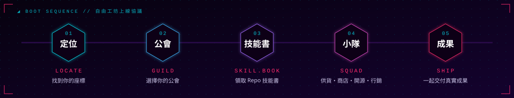

<div align="center">

<a href="https://freetwai.com"></a>

<a href="https://freetwai.com"></a>


**`> 自由工坊 — AI 自由平台。人與 Agent 並肩，在開放的程式碼上建造自己的未來。_`**

</div>

<br>

## `▍01` 自由協定 // MANIFESTO

> 霓虹底下沒有誰天生擁有權限。你寫下的每一行 commit，才是你的身分。

- **`OPEN`** 程式碼是公開的語言。讀它、fork 它、改它，再把成果送回來。
- **`PROOF > TITLE`** 公會職稱不授予寫入權；真實的 PR、review 與 merge 紀錄才是你的履歷。
- **`HUMAN + AGENT`** AI 是隊友，不是代筆。使用 AI 時如實交代協作範圍。
- **`YOUR DATA, YOUR KEYS`** 秘密、token 與客戶資料不進公開 Issue／PR，也不離開你的掌控。
- **`SQUAD > SILO`** 一個人走得快，一隊人走得遠。供貨、商店、開源、行銷，組隊完成。

<br>

## `▍02` 上線協議 // BOOT SEQUENCE

<div align="center">

</div>

在 [freetwai.com](https://freetwai.com) 完成定位、選擇公會並領取 Repo 技能書，再以供貨、商店、開源作品、行銷與小隊共同完成成果。

<br>

## `▍03` 城市地圖 // SECTORS

| 區域 | 節點 | 用途 |
| :-- | :-- | :-- |
| **`◈ CORE`** 核心 | [`freedom-platform`](https://github.com/FreeTWAI/freedom-platform) | 平台核心：modular monolith、中央契約與 runtimes |
| | [`freedom-project-template`](https://github.com/FreeTWAI/freedom-project-template) | 新專案起手式（`gh --template`） |
| | [`freedom-project-page`](https://github.com/FreeTWAI/freedom-project-page) | Manifest 驗證、GitHub 檢查、專案頁產生器 |
| | [`.github`](https://github.com/FreeTWAI/.github) | 組織介紹、社群範本與唯讀 reusable workflow |
| **`◈ AGENT`** 代理 | [`freedom-agent-kit`](https://github.com/FreeTWAI/freedom-agent-kit) | Agent 協定與 CLI adapters（Claude / Codex / Grok） |
| | [`freedom-browser`](https://github.com/FreeTWAI/freedom-browser) | 開源 Agentic 瀏覽器 |
| | [`freedom-browser-extension`](https://github.com/FreeTWAI/freedom-browser-extension) | Chrome MV3 執行端：配對、明選 BYOK、受控 DOM 工具 |
| **`◈ MARKET`** 市集 | [`freedom-storefront`](https://github.com/FreeTWAI/freedom-storefront) | 可 fork 的商店模板 |
| | [`freedom-supplier-client`](https://github.com/FreeTWAI/freedom-supplier-client) | 供應端客戶端：會員核准的私人讀取連線 |
| | [`freedom-growth-automation`](https://github.com/FreeTWAI/freedom-growth-automation) | 成長與媒體自動化 workers |
| **`◈ GUILD`** 技能書 | [`freedom-skill-registry`](https://github.com/FreeTWAI/freedom-skill-registry) | 公開 Skill 套件索引；各公會技能書皆以 `freedom-skill-*` 命名 |

> [!TIP]
> 正式產品 repo 一律以 `freedom-*` 開頭。其餘公開 repo 是社群成員帶進工坊的開源作品，歡迎逛逛 [全部 repositories](https://github.com/orgs/FreeTWAI/repositories)。

<br>

## `▍04` 加入連線 // JACK IN

```console
$ freetwai connect --as builder
[ok] 1. 從目標 repo 的 Issues 認領範圍，先查既有 PR 避免重工
[ok] 2. 讀 CONTRIBUTING.md；交給 Agent 前先讓它讀 AGENTS.md
[ok] 3. 在自己的 fork／分支動手，附上實跑的驗證命令與結果
[ok] 4. 送出 PR，連回原 Issue，等待維護者 review
>>> welcome to the grid, builder._
```

- 協作規則：[CONTRIBUTING.md](https://github.com/FreeTWAI/.github/blob/main/CONTRIBUTING.md)　·　Agent 指引：[AGENTS.md](https://github.com/FreeTWAI/.github/blob/main/AGENTS.md)　·　安全回報：[SECURITY.md](https://github.com/FreeTWAI/.github/blob/main/SECURITY.md)

<br>

## `▍05` 系統狀態 // SYS.LOG

```yaml
node:       https://freetwai.com
enterprise: FreeTWAI · GHEC (personal accounts / non-EMU)
canonical:  freedom-* repositories
stage:      day-1 scaffold · incubating
coding:     Better Agent Terminal
org-ops:    Grok Bot operates org settings
```

<br>

<div align="center">

<sub><code>// END OF TRANSMISSION — 自由不是被給予的，是一起寫出來的 ▍</code></sub>

</div>
